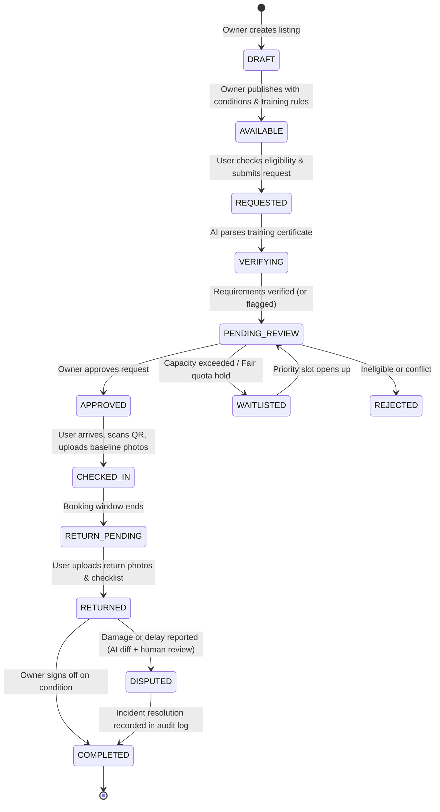

# OpenLabs AI — 48-Hour CodeHack Implementation Plan

**Problem Statement:** *Unlock Underused Equipment and Spaces*  
**Theme:** Build a trusted platform that helps institutions and communities safely share underused spaces, equipment, and technical resources.  
**Team Size:** 2 Members  
**Target Submission Score:** 100 / 100 Points

---

## 1. Team Division & Role Ownership

The CodeHack rules state:
> *"Every team member must submit individually. Each member must mention their actual role—such as Frontend, Backend, AI/ML, UI/UX, Product/Research or Presentation—and explain what they personally built."*

```
+--------------------------------------------------------------------------------+
|                                OPENLABS AI                                     |
+---------------------------------------+----------------------------------------+
| MEMBER 1: Backend, AI & Data Lead     | MEMBER 2: Frontend & UI/UX Design Lead |
| (Prakhar)                             | (Friend)                               |
+---------------------------------------+----------------------------------------+
| - Database Schema & Data Models       | - React Design System & Theme Engine   |
| - 10-Step Booking State Machine       | - Judge 1-Click Role Switcher          |
| - Anti-Monopolization / Quota Engine  | - Interactive Resource Catalog         |
| - Gemini AI Document Verification     | - Booking & Eligibility Upload Flow    |
| - Gemini AI Pre/Post Damage Diffing   | - Check-In/Return Condition Inspection |
| - Immutable Audit Trail & Logs        | - Live Audit Timeline & Incident UI    |
| - API Security & REST Endpoints       | - Mobile Responsiveness & Polish       |
+---------------------------------------+----------------------------------------+
```

---

## 2. System Architecture & The 10-Step Sharing Lifecycle

To satisfy Criterion #3 (*Working End-to-End Product — 20 Points*), the platform enforces this deterministic state machine:



---

## 3. Hour-by-Hour 48-Hour Sprint Schedule

### Phase 1: Foundation, Data Contracts & Setup (Hours 0 – 10)
- **Goal:** Backend connected to MongoDB, schemas defined, API contract locked; Frontend initialized with Vite + Tailwind + Lucide icons + Design Tokens.

| Member | Focus | Deliverables | Skills to Apply |
|---|---|---|---|
| **Member 1 (Backend)** | Schemas & State Machine | • Mongoose schemas (`User`, `Resource`, `Booking`, `ConditionLog`, `Incident`, `AuditLog`)<br>• Core lifecycle endpoints (`POST /resources`, `GET /resources`, `POST /bookings`)<br>• Seed script with realistic academic equipment (CNC mill, 3D printer, Biohood, Camera rig) | `backend-architecture`<br>`domain-modeling`<br>`implement` |
| **Member 2 (Frontend)** | App Shell & Design System | • Vite + React + Tailwind + Lucide Setup<br>• Theme tokens (status badges, modern dark/light card aesthetics)<br>• Global Header with **Judge Role Switcher** (`Requester` $\leftrightarrow$ `Lab Manager` $\leftrightarrow$ `Auditor`)<br>• Clean Mock Data Provider for parallel frontend development | `frontend-design`<br>`web-design-guidelines`<br>`vercel-composition-patterns` |

---

### Phase 2: Core Discovery & Request Workflow (Hours 10 – 22)
- **Goal:** Users can search and filter resources by qualification, submit booking requests, and upload verification credentials. Owners can approve/reject/waitlist.

| Member | Focus | Deliverables | Skills to Apply |
|---|---|---|---|
| **Member 1 (Backend)** | Eligibility & Quota Engine | • Anti-Monopolization logic: max weekly hours per user, quota calculation, fair-queue ordering<br>• Booking approval/rejection endpoints with required human justification<br>• Gemini API integration: Document OCR & safety cert validator endpoint (`POST /api/verify/certificate`) | `backend-architecture`<br>`tdd`<br>`systematic-debugging` |
| **Member 2 (Frontend)** | Catalog & Booking UI | • Resource Explorer with multi-attribute filtering (location, department, training required, availability calendar)<br>• Booking Request Modal with Certificate Upload & Instant AI preview feedback<br>• Owner Request Inbox with inline certificate inspector and 1-click Approve / Reject / Waitlist actions | `vercel-react-best-practices`<br>`frontend-design`<br>`vercel-composition-patterns` |

---

### Phase 3: Physical Custody, Check-In & Damage Diffing (Hours 22 – 34)
- **Goal:** Implement the physical custody lifecycle: QR Check-in, baseline photo capture, check-out return, and Gemini AI vision before-and-after damage comparison.

| Member | Focus | Deliverables | Skills to Apply |
|---|---|---|---|
| **Member 1 (Backend)** | Custody & AI Vision Diff | • Check-in endpoint (`POST /bookings/:id/checkin`) storing baseline condition photos & checklist<br>• Return endpoint (`POST /bookings/:id/return`) storing post-use condition<br>• Gemini Vision comparison endpoint: compares pre- vs post-use photos and generates structured anomaly scores<br>• Incident reporting & penalty/dispute workflow endpoints | `implement`<br>`backend-architecture`<br>`systematic-debugging` |
| **Member 2 (Frontend)** | Check-In & Return Inspection UI | • Check-In Screen: Interactive camera upload for baseline equipment condition with checklist (cleanliness, power-on, accessories)<br>• Return & Check-Out Screen: Post-use photo upload<br>• Visual Condition Inspector: Side-by-side photo comparison slider with AI-detected alert markers<br>• Incident & Damage Filing modal with severity level | `frontend-design`<br>`web-design-guidelines`<br>`vercel-react-view-transitions` |

---

### Phase 4: Audit History, Fair Allocation Dashboard & Polish (Hours 34 – 42)
- **Goal:** Tamper-evident audit timeline, fairness analytics, end-to-end integration testing, and deployment to Vercel.

| Member | Focus | Deliverables | Skills to Apply |
|---|---|---|---|
| **Member 1 (Backend)** | Audit Trail & Deployment | • Immutable audit log middleware capturing actor, timestamp, prior state, new state, and reason<br>• Fair usage metrics endpoint (`GET /analytics/fairness`) calculating resource utilization & monopolization index<br>• Production deployment on Render / Vercel Serverless + MongoDB Atlas | `backend-architecture`<br>`deploy-to-vercel`<br>`vercel-cli-with-tokens` |
| **Member 2 (Frontend)** | Audit UI & Judge Demo Mode | • Audit History Visualizer (chronological timeline of approvals, check-ins, returns)<br>• Fairness & Anti-Hoarding Dashboard (charts showing equitable distribution among departments)<br>• **"Judge Guided Tour" Banner**: A 1-click step-through button guiding evaluators through the 10 steps in 3 minutes<br>• Frontend deployment on Vercel | `web-design-guidelines`<br>`vercel-optimize`<br>`webapp-testing` |

---

### Phase 5: Verification, Demo Video & Submission PDF (Hours 42 – 48)
- **Goal:** Zero dead ends, complete written submission report in official format, recorded video demonstration.

| Member | Focus | Deliverables | Skills to Apply |
|---|---|---|---|
| **Both Members** | End-to-End Testing & Submission | • Cross-browser verification with live judge link<br>• 3-5 Minute demo video walkthrough covering the 10-step lifecycle<br>• Submission PDF (Use case, architecture, AI disclosure, member contribution breakdown)<br>• Final repository cleanup and README testing instructions | `verification-before-completion`<br>`writing-guidelines`<br>`code-review` |

---

## 4. Prompt-by-Prompt Execution Playbook (With Skill Triggers)

Use these targeted prompts directly during development to execute each module cleanly:

### Prompt Block 1 (Member 1 — Backend Core & Schemas)
```text
[Skills: backend-architecture, domain-modeling, implement]
Context: Building the backend for OpenLabs AI (Express + MongoDB).
Task:
1. Create Mongoose models in src/models/:
   - User (name, email, role: 'requester'|'owner'|'admin', department, safetyCerts: [{name, issueDate, expiryDate, verified}])
   - Resource (title, category: 'lab_space'|'equipment'|'fabrication_tool', department, location, availabilitySlots, requiredQualifications, hourlyQuotaLimit, ownerId, images)
   - Booking (resourceId, userId, startTime, endTime, status: 'requested'|'verifying'|'approved'|'waitlisted'|'rejected'|'checked_in'|'returned'|'disputed'|'completed', fairUsageScore, checkInRecord, returnRecord, rejectionReason)
   - AuditLog (bookingId, resourceId, actorId, action, fromState, toState, timestamp, metadata)
2. Implement an auditable state-transition helper that logs every booking change to AuditLog.
3. Write a seed script in src/db/seed.js with 6 realistic institutional resources (e.g., Haas Mini Mill CNC, Nikon Confocal Microscope, Formlabs 3L Resin Printer, VR Usability Suite).
Ensure clean ESM modules, structured error handling, and robust validation.
```

### Prompt Block 2 (Member 2 — Frontend Shell & Judge Demo Mode)
```text
[Skills: frontend-design, web-design-guidelines, vercel-composition-patterns]
Context: Building the React frontend for OpenLabs AI.
Task:
1. Initialize Vite React with Tailwind CSS and Lucide React.
2. Build the Global App Shell:
   - Modern, high-trust engineering aesthetic (slate/zinc dark palette with crisp emerald/amber accent states).
   - Top Header with persistent "Judge Demo Switcher": Allows instant toggling between "Dr. Elena Vance (Lab Manager / Owner)", "Alex Chen (Graduate Student / Requester)", and "Campus Safety Admin".
   - Navigation: [Explore Resources], [My Bookings & Custody], [Lab Manager Dashboard], [Fairness & Audit Trail].
3. Build a mock state store (or React Context) that loads seeded resources and allows seamless switching between user personas without page reload.
Ensure full WCAG AA contrast, no generic placeholder boxes, and zero layout shift.
```

### Prompt Block 3 (Member 1 — Fair Allocation & Quota Engine)
```text
[Skills: backend-architecture, tdd, implement]
Context: Implementing the Anti-Monopolization & Scheduling Engine.
Task:
1. Implement a Fair Allocation Service in src/services/allocationService.js:
   - Rule 1 (Weekly Hours Cap): Limits any individual user/team to a maximum configurable hours (e.g. 10 hrs/week) on high-demand equipment.
   - Rule 2 (Fair Waitlist Scoring): When a resource is oversubscribed, rank requests using:
     Score = (Days Since Last Booking * 2.0) - (Total Bookings This Month * 1.5) + (Urgency Weight).
   - Rule 3 (Cooldown Interval): Enforces a 30-minute buffer between consecutive bookings for maintenance/inspection.
2. Build endpoints:
   - POST /api/bookings (checks quota, either sets to 'requested' or 'waitlisted' with an explainable reason message).
   - GET /api/analytics/fairness (returns department-wise usage breakdown and monopoly prevention stats).
3. Include unit tests or inline validation ensuring edge cases (hoarding attempts, overlapping requests) are cleanly handled.
```

### Prompt Block 4 (Member 2 — Resource Explorer & Eligibility Flow)
```text
[Skills: frontend-design, vercel-react-best-practices, vercel-react-view-transitions]
Context: Building the Discovery & Booking Request UI.
Task:
1. Build ResourceCatalog.jsx:
   - Search bar with natural language intent chips ("Biohood with centrifuge", "Heavy metal CNC", "Weekend availability").
   - Filter sidebar: Category, Department, Safety Certification required, Instant vs Approval Required.
   - Resource Card with live availability pill, required training badges, and fair-usage quota indicator.
2. Build BookingModal.jsx:
   - Date & time slot picker highlighting peak vs off-peak hours.
   - Purpose & project description input.
   - "Eligibility & Safety Verification" step: Prompts the user to attach their required training certificate (PDF/PNG) if they don't have it on file.
   - Submits request and displays instant feedback on whether it was slotted into PENDING_REVIEW or WAITLIST with explanation.
```

### Prompt Block 5 (Member 1 — Gemini AI Document & Damage Verification)
```text
[Skills: backend-architecture, implement, systematic-debugging]
Context: Implementing AI services using Google Gemini 2.5 / Flash for OpenLabs AI.
Task:
1. Create src/services/aiService.js:
   - verifyCertificationDoc(fileBuffer, requiredCertName): Uses Gemini to extract certificate holder name, certification title, issuing authority, and expiration date. Returns { isValid: boolean, confidence: number, extractedDetails: object, flagReason: string }.
   - compareConditionPhotos(beforePhotoUrl, afterPhotoUrl, checklistNotes): Compares baseline check-in photo vs return photo. Returns { anomalyDetected: boolean, riskLevel: 'low'|'medium'|'high', visualDifferences: string[], damageDescription: string, humanReviewRequired: true }.
2. Expose endpoints:
   - POST /api/ai/verify-cert
   - POST /api/ai/inspect-condition
3. Guarantee fallback resilience: If AI call times out, fallback to manual reviewer queue without crashing the booking flow.
```

### Prompt Block 6 (Member 2 — Check-In, Return & Condition Diff UI)
```text
[Skills: frontend-design, web-design-guidelines, vercel-composition-patterns]
Context: Building the physical custody check-in and return UI.
Task:
1. Build CustodyCheckInModal.jsx:
   - Step 1: Simulated QR code scanner / verification pin.
   - Step 2: "Baseline Condition Record": Upload 2-3 photos of the equipment at start.
   - Step 3: Interactive checklist: Cleanliness verified, No visible structural damage, Accessories inventory intact.
   - Confirms Check-In and transitions state to CHECKED_IN.
2. Build ReturnAndInspectModal.jsx:
   - Step 1: Upload return condition photos.
   - Step 2: "AI Condition Comparison": Side-by-side comparison displaying before vs after photos with Gemini AI anomaly highlights.
   - Step 3: Fast-path return button OR "Report Incident / Damage" toggle with severity and notes.
3. Live state update reflects instantly on the manager dashboard and user custody tracker.
```

### Prompt Block 7 (Member 2 — Audit Trail & Manager Dashboard)
```text
[Skills: frontend-design, web-design-guidelines, vercel-react-best-practices]
Context: Building the Trust, Safety & Manager Oversight Dashboard.
Task:
1. Build ManagerDashboard.jsx:
   - Pending Approvals queue with AI-verified credential summary badge.
   - Active Custody table showing who currently has what, check-in time, and return countdown timer.
   - Incident & Damage triage panel with AI diff summary and human sign-off actions.
2. Build AuditHistoryView.jsx:
   - Visual chronological timeline of every action taken on any asset (Requester booked -> System ran AI check -> Manager approved -> QR Check-in verified -> Returned -> Completed).
   - Tamper-evident formatting with timestamps, actor badges, and state transitions.
```

### Prompt Block 8 (Joint — Deployment, Review & Submission PDF)
```text
[Skills: deploy-to-vercel, verification-before-completion, writing-guidelines, code-review]
Context: Deploying and packaging OpenLabs AI for final CodeHack submission.
Task:
1. Deploy Frontend to Vercel and Backend to Render / Vercel Serverless. Verify live CORS, environment variables, and MongoDB Atlas connectivity.
2. Perform complete End-to-End Walkthrough:
   - Listing $\rightarrow$ Discovery $\rightarrow$ Verification $\rightarrow$ Approval $\rightarrow$ Check-In $\rightarrow$ Return $\rightarrow$ Incident diff $\rightarrow$ Audit trail.
3. Generate the required Project PDF Document with:
   - Selected Use Case (University Labs & Makerspaces).
   - Problem Statement & Why it Matters.
   - Full 10-Step Workflow Diagram & Feature List.
   - System Architecture, Tech Stack, and AI Disclosure.
   - Privacy, Safety & Fair-Allocation controls.
   - Credentials & Testing Guide for Judges.
   - Member 1 & Member 2 Role & Contribution breakdown.
```

---

## 5. Rubric Compliance Checklist

- [x] **Understanding of Problem (15 pts):** Clear focus on institutional liability, safety qualifications, and custody friction.
- [x] **Strength of Core Solution (20 pts):** Direct, practical solution tailored for university/makerspace equipment.
- [x] **Working End-to-End Product (20 pts):** All 10 steps operable in the UI with a 1-click Judge Demo switcher.
- [x] **Technical Depth & Reliability (15 pts):** MERN + Gemini architecture, auditable state machine, robust error handling.
- [x] **Trust, Safety & Accountability (10 pts):** Baseline photo logs, post-use return verification, damage reporting, immutable audit history.
- [x] **Fair Allocation & Accessibility (10 pts):** Explainable quota scoring, anti-hoarding cooldowns, transparent waitlists.
- [x] **Originality & Real-World Potential (10 pts):** Practical multimodal AI for certificate OCR & visual damage diffing with human-in-the-loop governance.

