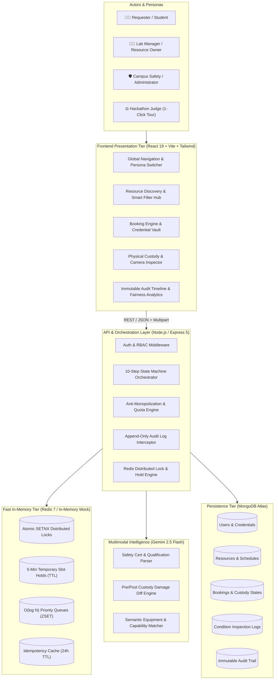
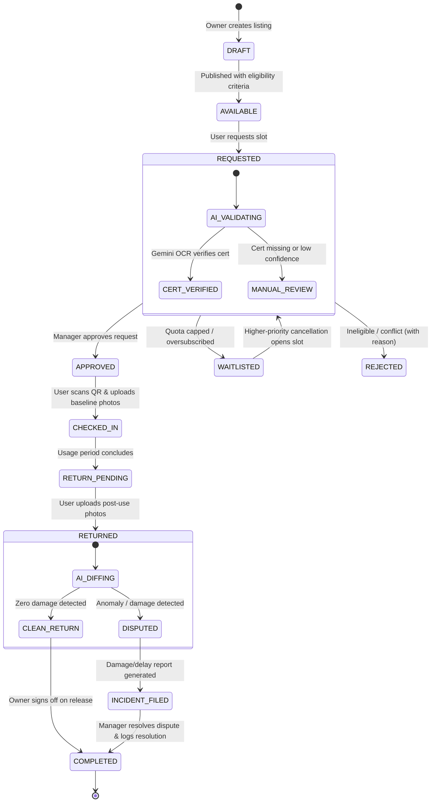
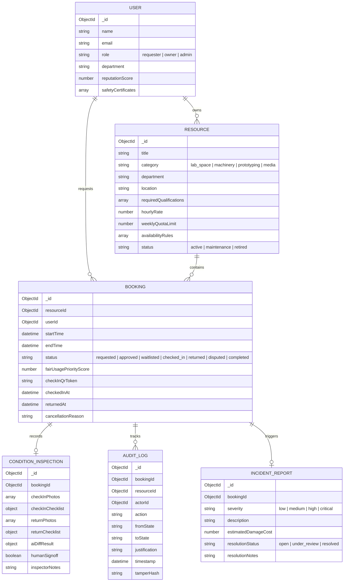

# ShareLab AI — Complete System Design & 48-Hour Implementation Blueprint
**Problem Statement:** *Unlock Underused Equipment and Spaces*  
**Hackathon Target:** 100/100 Points on Official Judging Rubric  
**Team Composition:** 2 Members (Member 1: Backend & AI Engine / Member 2: Frontend & UI/UX)

---

## 1. High-Level Architecture (HLD)

### 1.1 System Context & Interaction Topology



### 1.2 Architectural Boundaries & Design Principles
1. **Separation of Custody vs. Booking:** A reservation (time slot) is logically decoupled from physical custody (possession of asset). Custody only transfers upon verified check-in.
2. **Deterministic Governance with AI Advising:** AI performs heavy cognitive lifting (OCR on certificates, visual anomaly detection on equipment photos), but **never executes final punitive or access decisions**. All AI outputs carry confidence scores and route to human managers for sign-off.
3. **Immutable Audit Trail:** State transitions emit an append-only event record storing actor ID, timestamp, prior state, next state, digital payload hash, and optional manager justification.

---

## 2. Low-Level Design (LLD)

### 2.1 Complete 10-Step State Machine Specification



#### Detailed State Transition Matrix

| # | Current State | Event / Trigger | Actor | Pre-Conditions | Next State | Automated System Actions |
|---|---|---|---|---|---|---|
| **1** | `NONE` | `CREATE_LISTING` | Owner | Verified Owner profile | `AVAILABLE` | Indexes location, category, qualification tags |
| **2** | `AVAILABLE` | `SUBMIT_REQUEST` | Requester | User under weekly quota cap | `REQUESTED` | Runs QuotaEngine check; triggers Gemini OCR |
| **3** | `REQUESTED` | `OCR_SUCCESS` | System (AI) | Cert valid & non-expired | `PENDING_OWNER` | Attaches `{ certVerified: true, confidence: 0.96 }` |
| **4** | `PENDING_OWNER` | `APPROVE` / `WAITLIST` | Owner | Available capacity | `APPROVED` / `WAITLISTED` | Generates secure Check-in QR Token; logs to Audit |
| **5** | `APPROVED` | `PERFORM_CHECKIN` | Requester | Current time within slot window | `CHECKED_IN` | Requires baseline photos & 3 checklist toggles |
| **6** | `CHECKED_IN` | `INITIATE_RETURN` | Requester | Asset returned to station | `RETURNED` | Requires return photos; invokes Gemini Vision Diff |
| **7** | `RETURNED` | `SIGN_OFF_CLEAN` | Owner | AI diff score < 0.15 | `COMPLETED` | Releases deposit hold; frees slot for next user |
| **8** | `RETURNED` | `REPORT_INCIDENT` | Owner/AI | AI diff score $\ge$ 0.15 or delay | `DISPUTED` | Generates incident ticket; freezes deposit |
| **9** | `DISPUTED` | `RESOLVE_INCIDENT` | Admin/Owner | Written settlement note | `COMPLETED` | Logs penalty/resolution to immutable audit trail |

---

### 2.2 Mathematical Anti-Monopolization & Fair Allocation Engine

To score **10/10 on Criterion #6 (Fair Allocation & Accessibility)**, the platform implements an explainable, transparent algorithm:

#### A. Oversubscribed Slot Priority Function
When multiple users request the same high-demand resource slot, the system ranks requests using:

$$\text{PriorityScore}(u, r, t) = \alpha \cdot \Delta t_{\text{idle}} + \beta \cdot \left(1 - \frac{H_{\text{used\_30d}}}{H_{\text{weekly\_cap}}}\right) + \gamma \cdot \text{Reputation}(u) - \delta \cdot \text{ActiveHolds}(u)$$

- $\Delta t_{\text{idle}}$: Days since the user last accessed this category of equipment (promotes rotation).
- $H_{\text{used\_30d}}$: Hours utilized by user $u$ in the past 30 days (penalizes monopolizers).
- $H_{\text{weekly\_cap}}$: Maximum allowable hours per week per user (e.g., 10 hrs for CNC mills).
- $\text{Reputation}(u)$: Score between $0.0$ and $1.0$ based on punctual returns and zero damage strikes.
- $\alpha=0.35, \beta=0.35, \gamma=0.20, \delta=0.10$: Standard tuning weights.

#### B. Anti-Hoarding Constraints
1. **Weekly Cap Enforcement:** If $H_{\text{used\_current\_week}} + H_{\text{requested}} > H_{\text{weekly\_cap}}$, the booking is automatically routed to `WAITLISTED` with explicit feedback: *"Weekly quota of 10h reached. You will receive excess capacity 2 hours prior to slot start."*
2. **Turnaround Cooldown Buffer:** A mandatory 30-minute buffer is automatically injected between bookings for equipment calibration and manager inspection.
3. **Departmental Parity Ceiling:** No single academic department can reserve $>40\%$ of prime-time slots (Mon-Fri 09:00–17:00) on critical institutional machinery.

---

### 2.3 Gemini Multimodal AI Integration Pipelines

#### Pipeline 1: Safety Certification & Credential Verification
- **Input:** Uploaded PDF or Image (Student ID, Laser Safety Level 2, Biosafety Level 1, Machine Shop Pass).
- **Gemini Model:** `gemini-2.5-flash` with structured JSON schema response.
- **System Prompt Extraction Schema:**
```json
{
  "isCredential": true,
  "holderName": "Alex Chen",
  "credentialName": "Certified Haas CNC Operator - Level 2",
  "issuingAuthority": "College of Engineering Makerspace",
  "issueDate": "2026-02-15",
  "expiryDate": "2027-02-15",
  "isExpired": false,
  "matchesRequiredQualification": true,
  "confidenceScore": 0.97,
  "flaggedConcerns": null
}
```

#### Pipeline 2: Before-and-After Visual Custody Damage Diffing
- **Input:** Baseline Check-In Photo (Array) vs. Post-Use Return Photo (Array).
- **System Prompt:** Evaluates structural integrity, missing tool heads, surface cracks, fluid leaks, or unauthorized modifications.
- **Gemini Response Schema:**
```json
{
  "visualAnomalyDetected": true,
  "confidenceScore": 0.92,
  "riskSeverity": "HIGH",
  "anomalies": [
    {
      "component": "Spindle Collet / Chuck",
      "issue": "Visible deep shearing mark and chipped end-mill shank not present in baseline photo 1",
      "coordinatesEstimate": {"x": 0.45, "y": 0.62}
    }
  ],
  "recommendedAction": "REQUIRE_HUMAN_INSPECTION",
  "humanSummary": "A potential end-mill fracture was detected on the spindle assembly. Inspect tool holder before releasing deposit."
}
```

---

### 2.4 Data Models & Database Schemas (MongoDB / Mongoose)



---

## 3. Deep Member-Wise Division of Ownership

To ensure both team members build with extreme velocity and zero merge conflicts, the system is partitioned into two independent, contract-driven halves:

```
┌─────────────────────────────────────────────────────────────────────────────┐
│                           SHARELAB ARCHITECTURE                             │
├──────────────────────────────────────┬──────────────────────────────────────┤
│ MEMBER 1: Backend, AI & Security     │ MEMBER 2: Frontend, UI/UX & Demo     │
│ (Prakhar)                            │ (Friend)                             │
├──────────────────────────────────────┼──────────────────────────────────────┤
│ 1. Express 5 App & MongoDB Setup     │ 1. Vite React + Tailwind + Lucide    │
│ 2. Mongoose Schemas & Validations    │ 2. Design System & Status Tokens     │
│ 3. 10-Step State Machine Controller  │ 3. 1-Click Judge Role Switcher       │
│ 4. Anti-Monopolization Quota Engine  │ 4. Resource Catalog & Dynamic Search │
│ 5. Gemini Document OCR Service       │ 5. Booking & Certificate Upload Flow │
│ 6. Gemini Visual Damage Diff Service │ 6. Check-In / QR & Photo Capture UI  │
│ 7. Append-Only Audit Logging Engine  │ 7. Visual Damage Diff Slider Screen  │
│ 8. REST Endpoints & Postman Tests    │ 8. Audit History & Manager Dashboard │
└──────────────────────────────────────┴──────────────────────────────────────┘
```

---

### Detailed Breakdown: MEMBER 1 (Backend, AI & Security)

#### Primary Responsibilities
1. **Data Layer & Schemas (`CrAp/backend/src/models/`):**
   - `User.js`, `Resource.js`, `Booking.js`, `ConditionInspection.js`, `AuditLog.js`, `Incident.js`.
2. **State Machine Controller (`CrAp/backend/src/controllers/bookingController.js`):**
   - Atomic transitions with strict state guards (e.g., cannot check-in unless state is `approved` and timestamp is valid).
   - Tamper-evident logging hook invoking `AuditLog.create()` on every single transition.
3. **Anti-Monopolization Service (`CrAp/backend/src/services/fairAllocationService.js`):**
   - User weekly usage accumulator.
   - Priority queue scoring function.
   - Cooldown buffer validator.
4. **Gemini AI Intelligence Service (`CrAp/backend/src/services/aiService.js`):**
   - `verifyCertificate(buffer, mimeType, certType)`: Calls Gemini 2.5 Flash for OCR extraction.
   - `compareCondition(baselineUrls, returnUrls, checklist)`: Calls Gemini Vision for anomaly diffing.
5. **REST API Routes (`CrAp/backend/src/routes/`):**
   - `/api/auth/switch-persona` (for judge demo).
   - `/api/resources` (CRUD & availability query).
   - `/api/bookings` (request, approve, reject, waitlist, check-in, return).
   - `/api/inspections` (photo upload & AI diff retrieval).
   - `/api/audit` (immutable chronological event stream).
   - `/api/analytics/fairness` (anti-monopolization metrics).
6. **Seed Data Generator (`CrAp/backend/src/db/seed.js`):**
   - Populates 6 high-value assets across 3 university labs with sample past audit histories and upcoming slots.

#### Skills Applied by Member 1
- `backend-architecture` — Production-grade Express structuring, error handling, and route modularization.
- `domain-modeling` — Relational consistency, state transitions, and audit schemas in MongoDB.
- `implement` — Clean, typed ESM implementation of core controllers.
- `tdd` — Unit testing state transitions and edge cases (quota caps, concurrent requests).
- `systematic-debugging` — Ensuring no unhandled promise rejections or race conditions.

---

### Detailed Breakdown: MEMBER 2 (Frontend, UI/UX & Judge Experience)

#### Primary Responsibilities
1. **Design System & Foundations (`CrAp/frontend/src/`):**
   - Tailwind styling configured for an institutional, high-trust engineering aesthetic (Dark slate/zinc `#09090b` canvas with crisp `#10b981` emerald, `#f59e0b` amber, and `#6366f1` indigo accents).
   - Unified Status Badges (`REQUESTED`, `VERIFYING`, `APPROVED`, `WAITLISTED`, `CHECKED_IN`, `RETURNED`, `DISPUTED`).
2. **1-Click Judge Experience Bar (`CrAp/frontend/src/components/common/JudgeBar.jsx`):**
   - Prominently anchored at the top of the screen.
   - 1-click switcher between 3 active personas:
     - 🎓 **Alex Chen (Graduate Researcher / Requester)**
     - 🔬 **Dr. Elena Vance (Lab Director / Resource Owner)**
     - 🛡️ **Campus Safety & Audit Inspector**
   - **"Guided Tour Mode" Button:** Automatically steps the judge through the complete 10-step lifecycle with pre-filled inputs.
3. **Resource Explorer (`CrAp/frontend/src/components/catalog/`):**
   - Multi-facet search (Department, Machine Category, Training Required, Instant vs Managed Approval).
   - Dynamic Resource Card displaying live status, weekly quota limit, and safety prerequisites.
4. **Booking & Eligibility Modal (`CrAp/frontend/src/components/booking/`):**
   - Interactive time-slot selector showing peak/off-peak indicators.
   - Drag-and-drop Certificate Uploader with live AI analysis spinner and real-time credential badge.
5. **Physical Custody Check-In & Return (`CrAp/frontend/src/components/custody/`):**
   - **Check-In Modal:** QR code display/scanner, 2-photo baseline camera capture, 3-point safety checklist.
   - **Return Modal:** Post-use photo upload, return checklist.
   - **Interactive Damage Diff Viewer:** Side-by-side comparison slider showing baseline photo vs. return photo with Gemini AI bounding boxes and anomaly callouts.
6. **Audit History & Fairness Dashboard (`CrAp/frontend/src/components/audit/`):**
   - Chronological vertical timeline rendering every state change with actor avatar, timestamp, and justification.
   - Fair-Share Utilization Chart showing departmental balance and blocked monopolization attempts.

#### Skills Applied by Member 2
- `frontend-design` — Building an intuitive, high-craft web application that feels like a production tool.
- `web-design-guidelines` — Pixel-perfect alignment, keyboard accessibility, contrast ratios, and responsive layout.
- `vercel-composition-patterns` — Flexible compound components (modals, sliders, tabs) without prop drilling.
- `vercel-react-best-practices` — Optimized re-rendering, suspense boundaries, and minimal bundle overhead.
- `vercel-react-view-transitions` — Fluid state transitions between catalog, booking, and inspection views.

---

## 4. Complete REST API Contract (The Handshake)

To enable 100% parallel development, this is the agreed API contract:

```
Base URL: http://localhost:8000/api

Authentication / Persona Switcher:
POST   /auth/switch-persona            Body: { role: "requester"|"owner"|"admin" }

Resources:
GET    /resources                      Query: ?category=&department=&search=
GET    /resources/:id                  Returns: Resource details + upcoming schedule
POST   /resources                      Body: { title, category, department, requiredCerts, hourlyRate, quota }

Bookings & Lifecycle:
POST   /bookings                       Body: { resourceId, startTime, endTime, purpose, certDocUrl }
GET    /bookings/my-bookings           Returns: Active & past bookings for current user
GET    /bookings/manager-inbox         Returns: Pending approvals & active custody items for owner
PATCH  /bookings/:id/approve           Body: { approvalNote }
PATCH  /bookings/:id/reject            Body: { reason }
PATCH  /bookings/:id/waitlist          Body: { waitlistRank }

Custody & Condition Inspection:
POST   /bookings/:id/checkin           Body: { baselinePhotos: [string], checklist: object }
POST   /bookings/:id/return            Body: { returnPhotos: [string], checklist: object }
GET    /bookings/:id/inspection        Returns: ConditionInspection record + AI diff analysis
POST   /bookings/:id/resolve-incident  Body: { action: "waive"|"charge_deposit", notes: string }

Audit & Analytics:
GET    /audit/timeline/:bookingId      Returns: Chronological audit events
GET    /analytics/fairness             Returns: Anti-monopolization metrics & department distribution
```

---

## 5. Judge Demonstration Script (3-Minute Winning Flow)

When judges evaluate the live deployment, they will execute this exact scripted journey without encountering friction:

```
[JUDGE DEMO FLOW]
       │
       ▼
1. Judge clicks "Alex Chen (Student)" in top banner
       │
       ▼
2. Discovers "Haas VF-2 Super Speed CNC Mill" in Catalog
   • Sees "Requires Laser/CNC Safety Level 2" badge
   • Sees "Fair Allocation: 6 hrs used this week / 10 hrs max"
       │
       ▼
3. Clicks "Request Booking" & attaches sample "Safety_Cert.pdf"
   • System triggers Gemini OCR: "✅ Verified: Haas CNC Level 2 (Exp: Dec 2027)"
   • Request submitted to State: REQUESTED
       │
       ▼
4. Judge clicks "Dr. Elena Vance (Lab Manager)" in top banner
   • Sees Alex's request at the top of the Approval Inbox
   • Inspects AI credential verification card
   • Clicks "Approve Access" (State -> APPROVED, QR generated)
       │
       ▼
5. Judge clicks "Alex Chen (Student)" -> Clicks "Check-In Equipment"
   • Scans QR code
   • Takes 2 Baseline Photos (Clean spindle, intact end-mill)
   • Confirms Checklist -> State: CHECKED_IN (Live custody timer starts)
       │
       ▼
6. Judge clicks "Initiate Return & Checkout"
   • Uploads Return Photo (Simulated scenario: chipped end-mill shank)
   • State -> RETURNED
       │
       ▼
7. AI Condition Comparison activates automatically
   • Gemini detects visual anomaly: "Chip detected on tool holder shank"
   • Severity: MEDIUM / Human Review Required
       │
       ▼
8. Judge clicks "Dr. Elena Vance (Manager)"
   • Reviews side-by-side photo comparison slider with AI anomaly callout
   • Selects "Record Normal Tool Wear - Waive Incident"
   • State -> COMPLETED
       │
       ▼
9. Judge opens "Audit History & Fairness Ledger"
   • Views complete 10-step timestamped immutable event chain
   • Observes real-time Departmental Parity & Monopolization chart
```

---

## 6. Execution Milestones & Time Allocation

```mermaid
gantt
    title 48-Hour Parallel Build Roadmap
    dateFormat  X
    axisFormat %H h

    section Member 1 (Backend)
    Schemas & State Machine        : 0, 10
    Fair Quota & Priority Engine   : 10, 18
    Gemini OCR & Vision Diff       : 18, 28
    Audit Log & Analytics Endpoints: 28, 36
    Integration, Seed & Deploy     : 36, 44

    section Member 2 (Frontend)
    Tailwind Setup & Judge Bar     : 0, 8
    Catalog & Filtering Hub        : 8, 16
    Booking & Cert Upload Modal    : 16, 24
    Custody Check-In & Diff Slider : 24, 34
    Audit Timeline & Polish        : 34, 42

    section Joint (Both)
    End-to-End Walkthrough Polish  : 40, 44
    Submission PDF & Video Demo    : 44, 48
```


