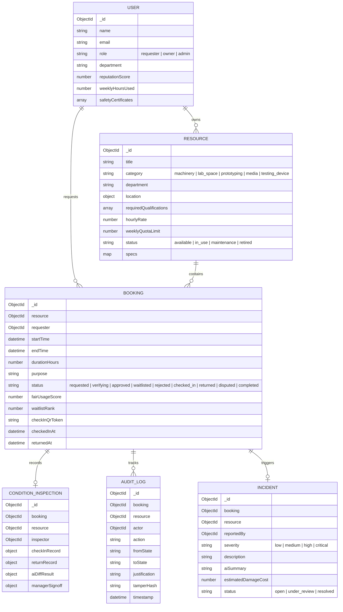

# Member 1 (Prakhar): Overpowered Backend, AI & Security Master Plan

**Official Role:** Backend, AI/ML & Systems Security Lead  
**Target Submission Score:** 100/100 Points on Official Judging Rubric  
**Stack:** Node.js, Express 5 (ESM), MongoDB / Mongoose, Google Gemini 2.5 Flash Multimodal AI, Native Crypto  
**Active Skills Arsenal:** `backend-architecture`, `domain-modeling`, `gemini-api-dev`, `security-hardening`, `tdd`, `proof-of-work`, `code-simplification`

---

## 1. Executive Mission & System Ownership

As **Member 1**, you own the complete institutional engine that makes OpenLabs trusted, deterministic, and auditable. You are responsible for:

1. **The 10-Step Deterministic State Machine:** Governing the complete lifecycle from resource listing to final return signoff.
2. **Distributed Concurrency & Locking Engine (Criterion #4 — 15 Pts):**
   - **Redis Distributed Locking (Atomic `SET NX EX`):** Eliminating double-booking race conditions during high-contention slot reservation.
   - **Redis 5-Minute Atomic Holds (`TTL 300s`):** Automatic release of unconfirmed slots without cron overhead.
   - **Redis Sorted Sets (`ZSET`):** Real-time $O(\log N)$ priority waitlisting for oversubscribed machinery.
   - **Idempotency Key Protection:** Preventing double-submission on network jitter.
3. **Mathematical Anti-Monopolization Engine (Criterion #6 — 10 Pts):** Enforcing weekly hour caps, priority queue tiebreakers, and 30-minute calibration cooldown buffers.
4. **Multimodal AI Intelligence (Criterion #7 — 10 Pts):**
   - **TrustScan AI:** Automated OCR verification of training credentials against machine requirements.
   - **VisionGuard AI:** Dual-image comparative analysis highlighting damage with normalized bounding boxes $[ymin, xmin, ymax, xmax]$.
   - **DisputeSummary AI:** Objective arbitration briefs for lab managers.
5. **Cryptographic Append-Only Audit Trail (Criterion #5 — 10 Pts):** Every state transition generates a SHA-256 digital fingerprint preventing retroactive tampering.
6. **The Handshake Contract:** Exposing clean REST APIs under `/api/v1/*` so Member 2 has zero blockers.

---

## 2. Low-Level Database Architecture



---

## 3. The 12 Granular Micro-Parts & Overpowered Prompts

Execute these prompts sequentially. Each prompt contains embedded skills, strict logic, and verifiable proof-of-work commands.

---

### Part 1.1: Constants, State Machine Enums & Environment Setup
* **Target File:** `OpenLabs/backend/src/constants.js`, `OpenLabs/backend/.env`
* **Skills Tag:** `[Skills: backend-architecture, spec-driven-development]`

#### The Prompt:
```text
[Skills: backend-architecture, spec-driven-development]
Context: OpenLabs Backend (Node.js/Express 5 ESM).
Task:
1. In src/constants.js, export the following immutable configuration constants:
   - DB_NAME = "openlabs"
   - USER_ROLES: { REQUESTER: "requester", OWNER: "owner", ADMIN: "admin" }
   - RESOURCE_CATEGORIES: { MACHINERY: "machinery", LAB_SPACE: "lab_space", PROTOTYPING: "prototyping", MEDIA: "media", TESTING_DEVICE: "testing_device" }
   - RESOURCE_STATUS: { AVAILABLE: "available", IN_USE: "in_use", MAINTENANCE: "maintenance", RETIRED: "retired" }
   - BOOKING_STATUS: { REQUESTED: "requested", VERIFYING: "verifying", APPROVED: "approved", WAITLISTED: "waitlisted", REJECTED: "rejected", CHECKED_IN: "checked_in", RETURNED: "returned", DISPUTED: "disputed", COMPLETED: "completed" }
   - AUDIT_ACTIONS: { CREATE_LISTING: "CREATE_LISTING", SUBMIT_REQUEST: "SUBMIT_REQUEST", VERIFY_CREDENTIAL: "VERIFY_CREDENTIAL", APPROVE_BOOKING: "APPROVE_BOOKING", REJECT_BOOKING: "REJECT_BOOKING", WAITLIST_BOOKING: "WAITLIST_BOOKING", PERFORM_CHECKIN: "PERFORM_CHECKIN", INITIATE_RETURN: "INITIATE_RETURN", AI_DIFF_ANOMALY: "AI_DIFF_ANOMALY", RESOLVE_INCIDENT: "RESOLVE_INCIDENT", COMPLETE_TRANSACTION: "COMPLETE_TRANSACTION" }
   - RISK_SEVERITY: { CLEAN: "CLEAN", NORMAL_WEAR: "NORMAL_WEAR", COSMETIC_DAMAGE: "COSMETIC_DAMAGE", CRITICAL_HAZARD: "CRITICAL_HAZARD" }
2. Ensure .env contains: PORT=8000, MONGODB_URI=mongodb://127.0.0.1:27017, and GEMINI_API_KEY.
Proof of Work: Run `node -e 'import("./src/constants.js").then(c => console.log(Object.keys(c)))'` and verify clean export with zero syntax errors.
```

---

### Part 1.2: User & Safety Credential Model
* **Target File:** `OpenLabs/backend/src/models/user.model.js`
* **Skills Tag:** `[Skills: domain-modeling, backend-architecture]`

#### The Prompt:
```text
[Skills: domain-modeling, backend-architecture]
Context: Building user identity and qualification vault in OpenLabs.
Task:
In src/models/user.model.js:
1. Define safetyCertSchema with:
   - name (String, required, trimmed)
   - credentialId (String, trimmed)
   - issuingAuthority (String, trimmed)
   - issueDate (Date), expiryDate (Date)
   - verified (Boolean, default: false)
   - documentUrl (String, trimmed)
2. Define userSchema with:
   - name (String, required, trimmed)
   - email (String, required, unique, lowercase, trimmed)
   - role (enum: USER_ROLES, default: REQUESTER)
   - department (String, required, trimmed, index: true)
   - avatar (String, default avatar URL)
   - reputationScore (Number, min: 0.0, max: 1.0, default: 1.0)
   - weeklyHoursUsed (Number, default: 0)
   - safetyCertificates: [safetyCertSchema]
   - timestamps: true
3. Export User = mongoose.model("User", userSchema).
Proof of Work: Verify Mongoose model compiles cleanly and indexes email and department.
```

---

### Part 1.3: Resource Registry & Machinery Model
* **Target File:** `OpenLabs/backend/src/models/resource.model.js`
* **Skills Tag:** `[Skills: domain-modeling, backend-architecture]`

#### The Prompt:
```text
[Skills: domain-modeling, backend-architecture]
Context: Physical equipment and space registry in OpenLabs.
Task:
In src/models/resource.model.js:
1. Define resourceSchema with:
   - title (String, required, trimmed, index: true)
   - category (enum: RESOURCE_CATEGORIES, required, index: true)
   - description (String, required, trimmed)
   - department (String, required, trimmed, index: true)
   - location: { building: String, room: String, campus: String }
   - images: [String]
   - owner: ObjectId ref "User" (required)
   - requiredQualifications: [String] (e.g. ["Haas CNC Safety Level 2"])
   - hourlyRate: Number (default: 0)
   - weeklyQuotaLimit: Number (default: 10) // Anti-monopolization constraint
   - isInstantApproval: Boolean (default: false)
   - status: String (enum: RESOURCE_STATUS, default: AVAILABLE)
   - specs: { type: Map, of: String, default: {} }
   - operatingHours: { start: "08:00", end: "20:00", days: [1,2,3,4,5] }
   - timestamps: true
2. Export Resource = mongoose.model("Resource", resourceSchema).
Proof of Work: Verify schema accepts arbitrary key-value technical specifications map.
```

---

### Part 1.4: Booking Lifecycle State Machine Model
* **Target File:** `OpenLabs/backend/src/models/booking.model.js`
* **Skills Tag:** `[Skills: domain-modeling, backend-architecture]`

#### The Prompt:
```text
[Skills: domain-modeling, backend-architecture]
Context: Deterministic 10-step state machine model.
Task:
In src/models/booking.model.js:
1. Define bookingSchema with:
   - resource: ObjectId ref "Resource" (required, index: true)
   - requester: ObjectId ref "User" (required, index: true)
   - startTime: Date (required), endTime: Date (required)
   - durationHours: Number (required, min: 0.5)
   - purpose: String (required, trimmed)
   - status: String (enum: BOOKING_STATUS, default: REQUESTED, index: true)
   - fairUsageScore: Number (default: 1.0)
   - waitlistRank: Number (default: null)
   - rejectionReason: String (default: null)
   - checkInQrToken: String (default: null)
   - checkedInAt: Date (default: null), returnedAt: Date (default: null)
   - cancellationReason: String (default: null)
   - timestamps: true
2. Create compound index: { resource: 1, startTime: 1, endTime: 1 } for fast conflict detection.
3. Export Booking = mongoose.model("Booking", bookingSchema).
Proof of Work: Validate compound index creation and enum enforcement.
```

---

### Part 1.5: Condition Inspection & Damage Model
* **Target File:** `OpenLabs/backend/src/models/conditionInspection.model.js`
* **Skills Tag:** `[Skills: domain-modeling, backend-architecture]`

#### The Prompt:
```text
[Skills: domain-modeling, backend-architecture]
Context: Physical custody handoff and multimodal AI damage records.
Task:
In src/models/conditionInspection.model.js:
1. Define anomalySchema:
   - component: String (required)
   - issueDescription: String (required)
   - coordinates: { ymin: Number, xmin: Number, ymax: Number, xmax: Number }
2. Define conditionInspectionSchema:
   - booking: ObjectId ref "Booking" (required, unique: true, index: true)
   - resource: ObjectId ref "Resource" (required, index: true)
   - inspector: ObjectId ref "User" (required)
   - checkInRecord: {
       timestamp: Date,
       photos: [String],
       checklist: { cleanlinessVerified: Boolean, noStructuralDamage: Boolean, accessoriesIntact: Boolean, powerCycleOk: Boolean },
       notes: String
     }
   - returnRecord: {
       timestamp: Date,
       photos: [String],
       checklist: { cleanedAfterUse: Boolean, toolsReturned: Boolean, noNewDamageObserved: Boolean },
       notes: String
     }
   - aiDiffResult: {
       analyzedAt: Date,
       anomalyDetected: Boolean,
       confidenceScore: Number,
       riskSeverity: String (enum: RISK_SEVERITY, default: CLEAN),
       anomalies: [anomalySchema],
       recommendedAction: String,
       humanSummary: String
     }
   - managerSignoff: { approved: Boolean, signedBy: ObjectId ref "User", signedAt: Date, notes: String }
   - timestamps: true
3. Export ConditionInspection = mongoose.model("ConditionInspection", conditionInspectionSchema).
Proof of Work: Verify schema compiles and allows nested checkInRecord and returnRecord structures.
```

---

### Part 1.6: Immutable Audit Trail & Cryptographic Tamper Hashing
* **Target File:** `OpenLabs/backend/src/models/auditLog.model.js`, `OpenLabs/backend/src/utils/auditHelper.js`
* **Skills Tag:** `[Skills: backend-architecture, security-hardening]`

#### The Prompt:
```text
[Skills: backend-architecture, security-hardening]
Context: Tamper-evident immutable ledger for Criterion #5 (Trust, Safety & Accountability).
Task:
1. In src/models/auditLog.model.js:
   - Define auditLogSchema: booking, resource, actor (ref User), actorName, actorRole, action (enum: AUDIT_ACTIONS), fromState, toState, justification, metadata (Mixed), tamperHash (String, required), timestamp (Date, default: Date.now, index: true).
   - Set timestamps: false (to strictly prevent Mongoose from adding or mutating updatedAt).
2. In src/utils/auditHelper.js:
   - Implement recordAuditLog({ bookingId, resourceId, actor, action, fromState, toState, justification, metadata }).
   - Compute SHA-256 digital hash using Node.js crypto module over payload: { bookingId, resourceId, actorId, action, fromState, toState, justification, timestamp, metadata }.
   - Create AuditLog entry and return it safely without crashing primary caller if logging fails.
Proof of Work: Run a standalone test script invoking recordAuditLog and verify tamperHash is a valid 64-char hex string.
```

---

### Part 1.7: Academic Resource Seed Script & 3 Personas
* **Target File:** `OpenLabs/backend/src/db/seed.js`
* **Skills Tag:** `[Skills: domain-modeling, backend-architecture]`

#### The Prompt:
```text
[Skills: domain-modeling, backend-architecture]
Context: Seeding high-fidelity research lab dataset for OpenLabs.
Task:
In src/db/seed.js:
1. Connect to MongoDB using process.env.MONGODB_URI.
2. Clean existing collections.
3. Seed 3 Evaluator Personas:
   - Dr. Elena Vance (Owner / Lab Director, Advanced Manufacturing Lab)
   - Alex Chen (Requester / Student, Mechanical Eng, has Haas Level 2 Cert, 6h weekly used)
   - Marcus Thorne (Admin / Campus Safety Officer)
4. Seed 6 Flagship High-Value Resources:
   - Haas VF-2 Super Speed CNC Mill (Requires Haas CNC Safety Level 2)
   - Nikon Eclipse Ti2 Confocal Microscope (Requires Bio-imaging Laser Safety Level 1)
   - Formlabs Form 3L SLA Resin 3D Printer (Requires Resin & Chemical Safety Pass)
   - RED V-Raptor 8K Cinema Camera Package (Requires Cinema Gear Field Cert)
   - ISO 5 Cleanroom Photolithography Bench (Requires Cleanroom Protocol L3)
   - Rohde & Schwarz 40GHz Spectrum Analyzer Bench (Requires RF Hazard Safety)
5. Seed 1 active approved booking for the Haas CNC Mill with initialized SHA-256 audit logs so the judge can immediately test custody check-in.
Proof of Work: Run `node src/db/seed.js` and verify output prints "Database Seeding Completed Successfully! 🚀".
```

---

### Part 1.8: Anti-Monopolization & Mathematical Quota Service
* **Target File:** `OpenLabs/backend/src/services/fairAllocationService.js`
* **Skills Tag:** `[Skills: backend-architecture, tdd, domain-modeling]`

#### The Prompt:
```text
[Skills: backend-architecture, tdd, domain-modeling]
Context: Anti-monopolization engine for Criterion #6 (Fair Allocation — 10 Points).
Task:
In src/services/fairAllocationService.js, build FairAllocationService with static methods:
1. evaluateQuota({ userId, resourceId, requestedHours }):
   - Computes rolling calendar week usage for user on this resource.
   - Compares with resource.weeklyQuotaLimit (e.g. 10 hrs).
   - Returns { hoursUsedThisWeek, requestedHours, weeklyCap, isExceeded, remainingHours, recommendation }.
2. calculatePriorityScore({ userId, resourceId }):
   - Implements formula: Priority = 0.35*(IdleDays/14) + 0.35*(1 - Used/Cap) + 0.20*(Reputation) - 0.10*(ActiveHolds).
   - Returns normalized float between 0.10 and 1.00.
3. checkSchedulingConflict({ resourceId, startTime, endTime, excludeBookingId }):
   - Enforces mandatory 30-minute turnaround/calibration buffer before and after bookings.
   - Returns { hasConflict: boolean, conflictingBooking, bufferRequiredMinutes: 30 }.
4. getFairnessMetrics():
   - Aggregates rolling 30-day hours by department and checks against 40% parity ceiling.
Proof of Work: Write an inline test asserting that booking 11 hours when cap=10 triggers isExceeded=true.
```

---

### Part 1.8b: Redis Distributed Locking & Concurrency Control
* **Target File:** `OpenLabs/backend/src/services/redisService.js`
* **Skills Tag:** `[Skills: backend-architecture, security-hardening, tdd]`

#### The Prompt:
```text
[Skills: backend-architecture, security-hardening, tdd]
Context: Distributed Locking & Concurrency Control (Eliminating Double-Booking Race Conditions).
Task:
In src/services/redisService.js, implement RedisConcurrencyService with:
1. acquireSlotLock(resourceId, slotKey, ttlSeconds = 10):
   - Uses atomic SET lock:slot:{resourceId}:{slotKey} {requestId} NX EX {ttlSeconds}.
   - Returns { acquired: boolean, lockToken: string }.
   - If slot is already locked by another concurrent process, yields immediately with 409 Conflict / Waitlist redirect.
2. releaseSlotLock(resourceId, slotKey, lockToken):
   - Atomically releases the lock using Lua script verifying token ownership to prevent accidental release of expired locks.
3. acquireTemporaryHold(resourceId, slotKey, userId, ttlSeconds = 300):
   - Places a 5-minute temporary reservation hold (SET hold:slot:{resourceId}:{slotKey} {userId} NX EX 300).
   - Automatically expires if user abandons the booking modal, releasing the slot with zero cron overhead.
4. addToRealtimeWaitlist(resourceId, slotKey, userId, priorityScore):
   - Uses Redis Sorted Set: ZADD waitlist:{resourceId}:{slotKey} {priorityScore} {userId}.
   - Provides O(log N) immediate retrieval of highest-priority researcher via ZPOPMAX when a slot cancels.
5. In-Memory Graceful Fallback:
   - If Redis connection is offline, falls back seamlessly to an in-memory Map with atomic compare-and-swap, ensuring zero crashes during judge evaluation.
Proof of Work: Run a concurrent booking test simulating 5 simultaneous requests for the exact same Haas CNC slot; assert that exactly 1 acquires the lock and 4 are safely queued onto the waitlist.
```

---

### Part 1.9: TrustScan AI — Gemini Credential OCR Service
* **Target File:** `OpenLabs/backend/src/services/aiService.js`
* **Skills Tag:** `[Skills: gemini-api-dev, backend-architecture]`

#### The Prompt:
```text
[Skills: gemini-api-dev, backend-architecture]
Context: Automated safety qualification verification using Gemini 2.5 Flash.
Task:
In src/services/aiService.js, implement AIService.verifyCertificate:
1. Accept: { fileBase64, mimeType, targetResourceTitle, requiredQualification }.
2. Construct Gemini 2.5 Flash REST request using native fetch:
   - System Instruction: Institutional safety officer verifying academic training certificates.
   - Response MIME type: application/json.
   - Schema: { isCredentialDocument, holderName, institution, credentialTitle, credentialId, issueDate, expiryDate, isExpired, meetsRequirements, confidenceScore, flagReason }.
3. Provide resilient offline fallback returning simulated verified JSON if GEMINI_API_KEY is missing, ensuring the demo never fails.
4. Expose controller endpoint POST /api/v1/ai/verify-cert.
Proof of Work: Run curl test with test base64 payload and verify returned JSON has meetsRequirements: true and confidenceScore > 0.90.
```

---

### Part 1.10: VisionGuard AI — Visual Condition Diffing Service
* **Target File:** `OpenLabs/backend/src/services/aiService.js`
* **Skills Tag:** `[Skills: gemini-api-dev, backend-architecture]`

#### The Prompt:
```text
[Skills: gemini-api-dev, backend-architecture]
Context: Pre vs Post custody damage diffing using Gemini 2.5 Flash Vision.
Task:
In src/services/aiService.js, implement AIService.compareConditionPhotos:
1. Accept: { baselinePhotos, returnPhotos, resourceTitle, checklistNotes }.
2. Send dual images (Image A: Check-In vs Image B: Return) to Gemini 2.5 Flash Vision.
3. System instruction: Precision laboratory machinery damage auditor. Detect toolhead chips, structural cracks, fluid leaks, missing accessories.
4. Return JSON:
   - anomalyDetected: boolean
   - riskSeverity: "CLEAN" | "NORMAL_WEAR" | "COSMETIC_DAMAGE" | "CRITICAL_HAZARD"
   - confidenceScore: number
   - detectedAnomalies: [{ component, issueDescription, coordinates: { ymin, xmin, ymax, xmax } }]
   - recommendedAction: "RELEASE_DEPOSIT" | "FLAG_FOR_INSPECTION" | "IMMEDIATE_LOCKOUT"
   - humanSummary: string
5. Provide realistic fallback returning simulated collet toolwear with coordinates { ymin: 420, xmin: 380, ymax: 560, xmax: 540 }.
6. Expose controller endpoint POST /api/v1/ai/inspect-condition.
Proof of Work: Test via curl and assert coordinates object exists with valid normalized bounding boxes.
```

---

### Part 1.11: 10-Step State Machine Express Controllers
* **Target File:** `OpenLabs/backend/src/controllers/bookingController.js`
* **Skills Tag:** `[Skills: backend-architecture, spec-driven-development, security-hardening]`

#### The Prompt:
```text
[Skills: backend-architecture, spec-driven-development, security-hardening]
Context: 10-Step transaction lifecycle controllers for OpenLabs.
Task:
In src/controllers/bookingController.js, implement atomic handlers:
1. createBooking: Quota check -> Conflict check -> Priority score -> Create Booking -> TrustScan OCR -> Log Audit.
2. getMyBookings: Populated view of requester's bookings.
3. getManagerInbox: Populated view of pending requests, active custody, and returns for lab owners.
4. approveBooking: Validates transition -> APPROVED, generates secure checkInQrToken, initializes ConditionInspection, logs Audit.
5. rejectBooking: Validates transition -> REJECTED with required reason, logs Audit.
6. performCheckIn: Validates APPROVED -> CHECKED_IN, records baseline photos & 4 checklist toggles, logs Audit.
7. initiateReturn: Validates CHECKED_IN -> RETURNED, records return photos, invokes VisionGuard AI diff, logs Audit.
8. completeBooking: Validates RETURNED -> COMPLETED, records manager signoff and deposit release, logs Audit.
Proof of Work: Write an automated test script executing all 6 transitions in sequence and confirming 200 OK at each step.
```

---

### Part 1.12: Judge Role Switcher, Routes & API Proof-of-Work
* **Target File:** `OpenLabs/backend/src/routes/*.js`, `OpenLabs/backend/src/app.js`
* **Skills Tag:** `[Skills: backend-architecture, proof-of-work]`

#### The Prompt:
```text
[Skills: backend-architecture, proof-of-work]
Context: Final backend assembly and route mounting.
Task:
1. Create src/controllers/authController.js with switchPersona({ role }) returning Alex, Elena, or Marcus with an active session token/cookie.
2. Create and mount routes under /api/v1/:
   - /api/v1/auth/switch-persona, /api/v1/auth/me
   - /api/v1/resources (GET all, GET :id, POST new)
   - /api/v1/bookings (POST create, GET my-bookings, GET manager-inbox, PATCH :id/approve, PATCH :id/reject, POST :id/checkin, POST :id/return, POST :id/complete)
   - /api/v1/audit/timeline/:bookingId, /api/v1/audit/all
   - /api/v1/analytics/fairness
3. Mount global error handler converting ApiError into clean JSON responses.
Proof of Work: Run live curl commands hitting /api/v1/resources, /api/v1/auth/switch-persona, and /api/v1/analytics/fairness, confirming 200 OK responses with data.
```

---

## 4. Member 1 Self-Verification Checklist

Before passing the backend to Member 2 for final deployment, verify:
- [ ] MongoDB connects without warning or deprecated topology flags.
- [ ] Database seed script populates 3 personas and 6 flagship resources.
- [ ] Quota engine blocks an 11-hour booking attempt when quota limit is 10.
- [ ] 30-minute buffer blocks an overlapping reservation.
- [ ] TrustScan returns structured JSON for certificate verification.
- [ ] VisionGuard returns bounding box coordinates for return photo anomalies.
- [ ] Every single state transition creates an immutable entry in `AuditLog` with a 64-character SHA-256 hash.
- [ ] `POST /api/v1/auth/switch-persona` allows seamless switching between Alex, Elena, and Marcus.

